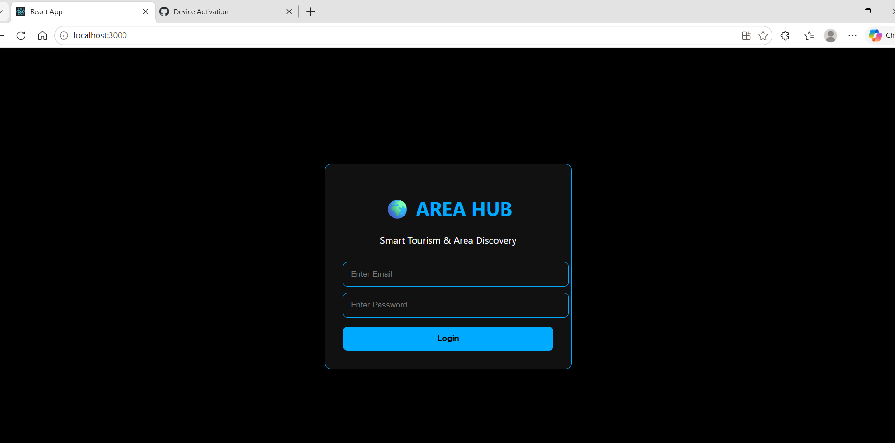

# Area-Hub-MERN
A place discovery web application built using the MERN stack
# Area Hub – MERN Stack Project

## 1. Project Overview

**Area Hub** is a full-stack web application developed using the MERN stack. It helps users explore places by category, search for places, and view information about interesting and historical locations.

The project provides a user-friendly interface for discovering places and managing place information through backend APIs.

## 2. Project Objectives

- Organize places into different categories.
- Help users discover interesting and historical locations.
- Provide search functionality to find places easily.
- Allow place information to be added, updated, and deleted.
- Support ratings for places.
- Build a responsive web interface connected to a backend database.

## 3. Technologies Used

| Technology | Purpose |
|---|---|
| HTML5 | Web page structure |
| CSS3 | Styling and layout |
| JavaScript | Application functionality |
| React.js | Frontend development |
| Node.js | Backend runtime |
| Express.js | REST API development |
| MongoDB | Database for storing place information |
| Bootstrap | Responsive UI components |
| Postman | API testing |

## 4. Main Features

- **Place Discovery:** Explore places and their details.
- **Category-Based Browsing:** Browse Featured Areas, Interesting Areas, and History Places.
- **Search:** Find places using search functionality.
- **Place Management:** Add, update, and delete place records.
- **Ratings:** Support ratings for places.
- **Authentication UI:** Login and registration interface.
- **Admin Dashboard:** Interface for managing place information.
- **Responsive Design:** Designed to support different screen sizes.
- **REST APIs:** Connect the React frontend to the Express backend.
- **Database Integration:** Use MongoDB to store place information.

*Note: The availability of each feature depends on the current implementation in the source code.*

## 5. Example Places

The application can display places such as:

- Mysore Palace – Historical Place
- Chamundi Hills – Religious Place
- Brindavan Gardens – Tourist Attraction
- Payana – Museum

These examples can be changed or expanded based on the data stored in the database.

## 6. Project Structure

```text
Area-Hub-MERN/
├── frontend/
│   ├── public/
│   ├── src/
│   │   ├── App.js
│   │   └── ...
│   ├── package.json
│   └── ...
├── backend/
│   ├── models/
│   │   └── Place.js
│   ├── routes/
│   │   └── placeRoutes.js
│   ├── server.js
│   └── ...
├── .gitignore
└── README.md
```

## 7. Prerequisites

Install the following before running the project:

- Node.js and npm
- MongoDB installed locally or a MongoDB Atlas database
- Visual Studio Code
- Git

## 8. Installation and Setup

### Step 1: Clone the repository

```bash
git clone https://github.com/RANJANA14/Area-Hub-MERN.git
cd Area-Hub-MERN
```

### Step 2: Install frontend dependencies

```bash
cd frontend
npm install
```

### Step 3: Install backend dependencies

Open another terminal from the project root and run:

```bash
cd backend
npm install
```

### Step 4: Configure the database

Configure the MongoDB connection string in the backend using the environment variable or configuration method supported by your code.

For example, if your backend uses environment variables, create a `backend/.env` file:

```env
PORT=5000
MONGO_URI=your_mongodb_connection_string
```

Replace the example connection string with your own MongoDB connection string. Do not upload passwords, database credentials, or secret keys to GitHub.

### Step 5: Start the backend

From the `backend` directory, use the start command defined in `backend/package.json`. If its script is named `start`, run:

```bash
npm start
```

### Step 6: Start the frontend

Open another terminal and run:

```bash
cd frontend
npm start
```

The React development server commonly opens at:

```text
http://localhost:3000
```

The backend commonly runs on port `5000` if configured that way. Check your actual configuration and API URL if the ports differ.

## 9. API and Testing

The backend uses Express routes to handle place-related operations. The place routes are located in:

```text
backend/routes/placeRoutes.js
```

The place data model is located in:

```text
backend/models/Place.js
```

Use Postman to test the API endpoints supported by the backend.

## 10. Learning Outcomes

Through this project, I gained practical experience in:

- Developing a React-based frontend.
- Creating REST APIs using Node.js and Express.js.
- Connecting an application to MongoDB.
- Organizing code into routes and models.
- Implementing CRUD operations.
- Testing APIs using Postman.
- Integrating frontend and backend components.
- Debugging application and database connection issues.

## 11. Future Enhancements

- Deploy the application for public access.
- Improve authentication and role-based access control.
- Add maps and location-based search.
- Add image uploads for places.
- Improve validation, error handling, and security.
- Add more location categories and advanced filters.

## 12. Author

**Ranjana K P**

B.E. Computer Science and Engineering  
GSSS Institute of Engineering and Technology for Women, Mysuru

## 13. Repository

GitHub: https://github.com/RANJANA14/Area-Hub-MERN

## Application Screenshot

